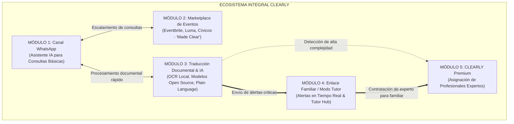

# **Product Requirements Document (PRD)**
# **CLEARLY — Tu comunidad. Más clara.** *(Your community. Made clear.)*

| Metadato | Detalle |
| :--- | :--- |
| **Nombre del Producto** | **CLEARLY** |
| **Versión del PRD** | 1.1.0 (Arquitectura Open Source & Local-First) |
| **Estado** | Aprobado para Desarrollo (Ready for Dev) |
| **Propietaria / Founder** | Navreet Pabla |
| **Fecha de Publicación** | Noviembre 2026 |
| **Clasificación** | Accesibilidad Digital, IA Cívica y Plataforma Comunitaria Local-First |
| **Documentos Relacionados** | [CLEARLY.md](file:///d:/IA-PROJECTS/app-clearly/Documentation/CLEARLY.md), Manual de Marca (*Brand Book*) |

---

## **1. Visión del Producto y Objetivos Estratégicos**

### **1.1 Declaración de Visión**
Convertir a **CLEARLY** en el ecosistema de referencia para la inclusión ciudadana y la accesibilidad comunitaria; eliminando las barreras del lenguaje burocrático, las brechas tecnológicas y el aislamiento social que sufren los adultos mayores, inmigrantes recién llegados y personas con discapacidad visual, al tiempo que se brinda tranquilidad a sus familiares mediante herramientas de tutoría y acompañamiento humano especializado.

### **1.2 Propuesta de Valor Única y Enfoque Tecnológico Soberano**
A diferencia de agregadores tradicionales o soluciones que dependen exclusivamente de APIs comerciales costosas y cerradas:
* **Soberanía y Privacidad Absoluta (Local-First):** Los documentos sensibles de salud y cartas de inmigración de adultos mayores se procesan prioritariamente mediante **modelos de IA Open Source y microservicios locales autohospedados**, garantizando privacidad de datos (PIPEDA/GDPR), evitando fugas hacia modelos de terceros y eliminando costos marginales por token o petición.
* **CLEARLY es accesible por diseño:** Interfaz nativa en tipografía *Atkinson Hyperlegible*, cumplimiento WCAG 2.1 AAA, lectura en voz alta (*TTS local*) y lenguaje simplificado (*Plain Language*).
* **CLEARLY es omnicanal:** Se adapta al nivel tecnológico del usuario, comenzando en **WhatsApp** (vía gateways libres/autohospedados) hasta la **App CLEARLY**.
* **CLEARLY conecta generaciones:** Integra el rol de **Tutor Familiar** (hijo/a cuidador), sincronizando alertas de fechas críticas en tiempo real.
* **CLEARLY es ético y humano:** Cuenta con un límite claro de IA y ofrece la opción de **CLEARLY Premium**, conectando al usuario con profesionales humanos expertos y verificados.

### **1.3 Objetivos de Negocio y Métricas de Éxito (OKRs & KPIs)**

| Objetivo Estratégico | Métrica Clave (KPI) | Meta a 6 Meses | Meta a 12 Meses |
| :--- | :--- | :--- | :--- |
| **Sostenibilidad Económica** | Costo marginal de inferencia y procesamiento por usuario | < $0.05 USD / usuario / mes | < $0.02 USD / usuario / mes (Hardware amortizado) |
| **Privacidad Ciudadana** | % de documentos sensibles procesados 100% en servidores locales | 100% en infraestructura local | 100% en infraestructura local |
| **Comprensión Ciudadana** | Tasa de comprensión efectiva de documentos analizados por IA | ≥ 92% de encuestados | ≥ 96% de encuestados |
| **Cumplimiento de Plazos** | Reducción de trámites/fechas límite vencidas en usuarios con Tutor | Reducción del 75% | Reducción del 90% |
| **Activación sin Fricción** | Usuarios activos mensuales (MAU) en WhatsApp vs. App | 10,000 en WhatsApp | 50,000 WhatsApp / 20,000 App |
| **Inclusión Social** | Asistencia real a eventos comunitarios descubiertos en el Marketplace | 1,500 asistencias | 10,000 asistencias |
| **Satisfacción del Cuidador** | NPS (*Net Promoter Score*) en Tutores Familiares | NPS ≥ 65 | NPS ≥ 75 |

---

## **2. Personas de Usuario y Casos Arquetípicos**

```
┌───────────────────────────┐     ┌───────────────────────────┐     ┌───────────────────────────┐
│     EL ADULTO MAYOR       │     │    EL TUTOR FAMILIAR      │     │  EL PROFESIONAL EXPERTO   │
│        (Elena, 74)        │     │        (Carlos, 41)       │     │        (David, 38)        │
│ • Baja alfabetización tech│     │ • Hijo adulto trabajador  │     │ • Gestor social/legal     │
│ • Usa WhatsApp diariamente│     │ • Fatiga de cuidador      │     │ • Revisa casos complejos  │
│ • Temor a cometer errores │     │ • Necesita visibilidad    │     │ • Acompañamiento humano   │
└───────────────────────────┘     └───────────────────────────┘     └───────────────────────────┘
```

### **Persona 1: El Adulto Mayor / Usuario Titular (Elena, 74 años)**
* **Contexto:** Vive sola en Brampton. Prefiere comunicarse en español. Ve borroso el texto pequeño y le intimidan los formularios web.
* **Canal Predilecto:** WhatsApp (mensajes de texto simples y notas de voz) y App en tablet con letras grandes.
* **Frustración:** Le da vergüenza pedirle a sus hijos que le lean cada carta o volante que llega por correo.
* **Necesidad:** Saber qué dice un documento, si es urgente, y qué actividades comunitarias gratuitas hay cerca de su casa.

### **Persona 2: El Tutor Familiar / Cuidador (Carlos, 41 años)**
* **Contexto:** Hijo de Rosa o Elena. Trabaja a tiempo completo y cuida de sus propios hijos ("generación sándwich").
* **Canal Predilecto:** App CLEARLY con notificaciones push prioritarias y alertas críticas por WhatsApp.
* **Frustración:** Enterarse tarde de que su madre recibió una carta con un plazo de 14 días que ya venció.
* **Necesidad:** Un panel transparente donde ver los recordatorios y checklists de su madre sin invadir su privacidad diaria.

### **Persona 3: El Inmigrante Recién Llegado (Mateo / Rosa, 19 - 62 años)**
* **Contexto:** Dominio básico del inglés. Enfrentan trámites de homologación, cartas de inmigración y correos universitarios complejos.
* **Necesidad:** Traducción empática contextual (no traducción robótica) y lista clara de tareas a ejecutar.

### **Persona 4: El Profesional Verificado CLEARLY Premium (David, 38 años)**
* **Contexto:** Trabajador social o asesor legal de inmigración certificado.
* **Canal:** Portal de Expertos CLEARLY (Dashboard web).
* **Necesidad:** Recibir un expediente claro y pre-estructurado para resolver la situación del cliente rápidamente y sin burocracia.

---

## **3. Alcance del Ecosistema de Servicios (Los 5 Módulos Core)**

CLEARLY se compone de cinco módulos funcionales interconectados:



---

## **4. Estudio Comparativo: Servicios Comerciales vs. Alternativas Open Source Locales**

A continuación se detalla la evaluación técnica de cada componente para reemplazar servicios de suscripción o pago por uso por tecnologías libres, autohospedadas y sin licenciamiento comercial restrictivo:

| Capa del Sistema | Servicio de Terceros Pago | Alternativa Open Source / Local Seleccionada | Ventajas de la Opción Local / Open Source |
| :--- | :--- | :--- | :--- |
| **Modelos LLM (Razonamiento & Lenguaje Claro)** | OpenAI GPT-4o / Google Gemini API | **Llama 3.1 / 3.2 (8B & 3B Instruct) / Qwen 2.5 (7B/14B)** ejecutado con **vLLM / Ollama** | • Cero costo de tokens por documento.<br>• Privacidad total: ningún dato viaja a OpenAI o Google.<br>• Cuantización GGUF/AWQ para alta velocidad en GPUs de consumo o servidores propios. |
| **Modelos de Visión & OCR (Lectura de Documentos)** | Google Cloud Vision API ($1.50/1000 págs) / AWS Textract | **PaddleOCR (PP-OCRv4) + Surya OCR / Marker** ó **Qwen2-VL (7B) / Llama 3.2 Vision (11B)** | • Extracción precisa de texto, sellos y tablas complejas.<br>• Sin límites de páginas ni facturación mensual variable.<br>• Ejecución local en contenedores Docker. |
| **Reconocimiento de Voz (STT - Speech to Text)** | OpenAI Whisper API ($0.006/min) / Google Speech | **faster-whisper (CTranslate2)** | • Hasta 4 veces más rápido que Whisper original con un 50% menos de VRAM.<br>• Soporte nativo sobresaliente en Español, Inglés y Punjabi.<br>• Transcribe notas de voz de WhatsApp localmente en < 1 segundo. |
| **Síntesis de Voz (TTS - Text to Speech)** | ElevenLabs / Google Cloud TTS | **Piper TTS** (Open Home Foundation) / **Bark** | • Piper corre en tiempo real incluso en CPU, ultra liviano (< 50MB de RAM).<br>• Voces naturales de alta calidad en múltiples idiomas y dialectos.<br>• Cero latencia de red y sin tarifas por carácter reproducido. |
| **Embeddings & Vector Search (RAG)** | OpenAI text-embedding-3 / Pinecone DB ($70+/mes) | **BGE-M3 (BAAI)** + **pgvector (PostgreSQL local)** | • Modelo multilingüe soberano de 8192 tokens de contexto.<br>• Base de datos vectorial integrada en PostgreSQL sin servicios externos. |
| **Gateway de WhatsApp** | Twilio WhatsApp API / Meta Cloud API (pago por plantilla/conversación) | **Evolution API / WPPConnect** (Open Source) + **Chatwoot** | • Conecta cuentas de WhatsApp vía WebSockets/Node sin costo por mensaje enviado.<br>• Control total de webhooks, audios, fotos y botones interactivos.<br>• Panel de soporte multicanal autohospedado con Chatwoot Community Edition. |
| **Almacenamiento de Archivos (Object Storage)** | AWS S3 / Cloudflare R2 | **MinIO (Self-hosted Object Storage)** | • 100% compatible con API S3.<br>• Cifrado local en discos propios.<br>• Cero costos de transferencia de salida (*egress fees*). |
| **Motor de Búsqueda de Eventos & Scraping** | Apify / ScrapingBee ($49+/mes) | **Crawlee / Playwright Open Source + SearXNG** | • Scraping ético local de bibliotecas, centros cívicos y agregadores públicos.<br>• Meta-buscador de privacidad SearXNG local. |

---

## **5. Especificaciones Funcionales Detalladas (Functional Requirements)**

### **MÓDULO 1: Canal de WhatsApp (Asistente IA Local CLEARLY)**

#### **1.1 Propósito**
Ofrecer una puerta de entrada conversacional con cero fricción técnica, accesible para usuarios de cualquier edad o nivel de alfabetización digital, operando sobre infraestructura autohospedada.

#### **1.2 Requerimientos Funcionales (FR-W1 a FR-W6)**
* **FR-W1 (Interacción por Voz con Stack Local):** El sistema debe procesar notas de voz enviadas por los usuarios utilizando **faster-whisper** desplegado localmente, interpretar la intención con **Llama 3.2 3B / Llama 3.1 8B**, y responder con texto formateado y notas de voz sintetizadas en tiempo real mediante **Piper TTS**.
* **FR-W2 (Consultas Básicas Comunitarias):** El asistente debe responder dudas sobre horarios y servicios de bibliotecas, centros cívicos, parques locales y trámites comunes en lenguaje sencillo, consultando la base de datos local PostgreSQL.
* **FR-W3 (Lectura Rápida de Fotos con OCR Local):** El usuario puede enviar una fotografía de un volante o letrero. El módulo de visión local (**PaddleOCR / Qwen2-VL**) extrae la información y responde en un máximo de 3 viñetas (*¿Qué evento es?*, *¿Cuándo y dónde?*, *¿Es gratis o de pago?*).
* **FR-W4 (Detección de Idioma Automática):** El canal detecta el idioma del remitente (español, inglés, punjabi, francés) y responde de forma consistente sin requerir configuración previa.
* **FR-W5 (Enrutamiento Seguro y Límites Éticos):** Si la consulta contiene datos médicos críticos, legales o documentos extensos, el asistente emite un mensaje empático orientando al usuario a abrir la **App CLEARLY** o a solicitar un **Experto Premium**.
* **FR-W6 (Gateway Autohospedado):** La comunicación con WhatsApp se gestiona a través de una instancia local de **Evolution API**, asegurando que los mensajes se transmitan directamente entre los servidores de CLEARLY y el usuario sin intermediarios comerciales de cobro por mensaje.

---

### **MÓDULO 2: Marketplace de Eventos Comunitarios (App CLEARLY)**

#### **2.1 Propósito**
Centralizar y accesibilizar la oferta de eventos sociales, culturales, recreativos y educativos mediante motores de ingesta abiertos y locales.

#### **2.2 Requerimientos Funcionales (FR-M1 a FR-M8)**
* **FR-M1 (Motor de Ingesta Abierto):** Pipeline de ingesta basado en conectores públicos para:
  * API pública de Eventbrite y feeds de Luma.
  * Agentes de extracción local con **Playwright / Crawlee** para agendas web de bibliotecas municipales, centros comunitarios de recreación y ONGs locales.
* **FR-M2 (Transformación 'Made Clear' por LLM Local):** Cada evento ingerido es procesado por el modelo local **Llama 3.1 8B**, el cual reescribe la descripción bajo la metodología de 4 respuestas obligatorias:
  * *¿Qué es el evento?* (Máximo 60 palabras, lectura simple).
  * *¿Cuándo y dónde?* (Fecha en lenguaje humano, paradas de transporte público cercanas y accesos adaptados).
  * *¿Costo?* (Indicación explícita: GRATUITO o valor exacto en moneda local).
  * *¿Cómo registrarse paso a paso?* (Instrucciones claras).
* **FR-M3 (Filtros de Accesibilidad Real):** Acceso en silla de ruedas garantizado, apto para adultos mayores, actividades multilingües y eventos 100% gratuitos.
* **FR-M4 (Modos de Visualización Inclusivos):** Tipografía nativa **Atkinson Hyperlegible** con selector de tamaño (100% a 200%) y temas de contraste adaptativo (Claro, Oscuro, Alto Contraste).
* **FR-M5 (Lector en Voz Alta Local):** Síntesis de voz instantánea mediante **Piper TTS** integrado en el navegador/app con control de velocidad (0.75x, 1x, 1.25x).
* **FR-M6 (Inscripción Guiada & Calendario):** Auto-registro asistido o enlace directo, con exportación a calendarios estándar y archivo `.ics`.
* **FR-M7 (Notificación al Tutor):** Opción de marcar *"Quiero ir con mi familia"*, notificando al Tutor asociado.

---

### **MÓDULO 3: Traducción Documental y Acompañamiento IA (App CLEARLY)**

#### **3.1 Propósito**
Empoderar al usuario para que comprenda con exactitud cartas gubernamentales, correspondencia médica y contratos con procesamiento 100% privado en infraestructura local.

#### **3.2 Requerimientos Funcionales (FR-D1 a FR-D7)**
* **FR-D1 (Captura y Preprocesamiento OCR Local):** Cámara inteligente con detección automática de bordes y balance de blancos. El documento se procesa localmente con **PaddleOCR / Surya OCR**, preservando la disposición de tablas, fechas y firmas.
* **FR-D2 (Motor de Lenguaje Claro Soberano):** Procesamiento mediante **Llama 3.1 8B / Qwen 2.5 14B** optimizado para lectura en nivel primario, libre de tecnicismos legales.
* **FR-D3 (Estructura de Tres Capas):**
  1. **Qué significa:** Resumen en 2-3 oraciones en el idioma materno del usuario.
  2. **Qué debes hacer (Checklist Interactivo):** Pasos exactos y casillas de verificación marcables.
  3. **Puntos de Aclaración:** Detección de ambigüedades en el texto original y preguntas recomendadas para la entidad emisora.
* **FR-D4 (Detección de Fechas Críticas):** Extracción algorítmica y cálculo exacto de plazos límites y fechas de caducidad.
* **FR-D5 (Chat Contextual RAG con Embeddings Locales):** Interfaz de chat asistido indexada con **BGE-M3** y **pgvector**. Cada respuesta cita el párrafo o página original del documento.
* **FR-D6 (Advertencia de No Alucinación):** Si la información no figura en el texto o está borrosa, el modelo responde estrictamente: *"Esta información no aparece en la carta. Te recomendamos consultar directamente o contactar a un experto CLEARLY Premium"*.
* **FR-D7 (Exportación y Compartición Cifrada):** Exportación en PDF accesible o compartición directa vía enlace seguro y cifrado con el Tutor.

---

### **MÓDULO 4: Asociación de Tutor / Enlace Familiar (App CLEARLY)**

#### **4.1 Propósito**
Establecer un puente de confianza intergeneracional entre el adulto mayor y su hijo/a o cuidador, brindando supervisión pasiva y alertas tempranas sin vulnerar la autonomía personal.

```
┌───────────────────────────────────────────────────────────────────────────┐
│                        FLUJO DEL MODO TUTOR                               │
│                                                                           │
│  [ADULTO MAYOR]                                           [TUTOR / HIJO]  │
│  Genera código de enlace (QR / 6 dígitos) ──────────────> Ingresa código  │
│  Autoriza permisos de forma granular      <────────────── Confirma vínculo│
│                         │                                        │        │
│                         ▼                                        ▼        │
│             Escanea carta con fecha límite             Recibe Alerta Push │
│             o agenda cita médica                       y WhatsApp         │
│                         │                                        │        │
│                         ▼                                        ▼        │
│             Avanza en su checklist                     Supervisa en el    │
│             con soporte de la IA                       "Tutor Hub"        │
└───────────────────────────────────────────────────────────────────────────┘
```

#### **4.2 Requerimientos Funcionales (FR-T1 a FR-T7)**
* **FR-T1 (Vinculación Segura por Código o QR):** El usuario titular genera un código numérico temporal o QR para emparejamiento con la app del tutor.
* **FR-T2 (Consentimiento Granular y Revocación):** El titular decide qué áreas comparte (alertas críticas, documentos traducidos, eventos comunitarios) y puede revocar accesos en cualquier momento.
* **FR-T3 (Alertas Proactivas Prioritarias):** Notificación inmediata al tutor cuando se escanea un documento con fecha límite menor a 15 días, o cuando faltan 48 horas para un plazo con checklist incompleto (vía Push y mensaje por WhatsApp).
* **FR-T4 (Dashboard 'Tutor Hub'):** Vista unificada con estado general del familiar, calendario compartido de citas y checklist colaborativo.
* **FR-T5 (Soporte Multi-Tutor y Multi-Titular):** Un hijo puede ser tutor de ambos padres, y varios hermanos pueden supervisar a un mismo titular.
* **FR-T6 (Escalamiento a Premium por el Tutor):** El tutor puede solicitar y pagar un profesional de **CLEARLY Premium** para su familiar.

---

### **MÓDULO 5: CLEARLY Premium (Acompañamiento Profesional Especializado)**

#### **5.1 Propósito**
Ofrecer una red humana confiable para aquellos momentos decisivos donde la tecnología no puede ni debe sustituir el criterio legal, social o de salud presencial.

#### **5.2 Requerimientos Funcionales (FR-P1 a FR-P7)**
* **FR-P1 (Directorio de Profesionales Verificados):** Gestores de inmigración, trabajadores sociales, navegadores de salud, traductores oficiales y asesores tributarios comunitarios.
* **FR-P2 (Verificación de Credenciales - KYC/KYB):** Validación de antecedentes penales, licencia profesional activa y adhesión al código ético.
* **FR-P3 (Matching Asistido por IA):** Sugerencia de profesional basada en el trámite, idioma materno y cercanía geográfica.
* **FR-P4 (Expediente Digital Previo):** Traspaso seguro del resumen estructurado por la IA para optimizar la consulta.
* **FR-P5 (Modalidades de Servicio):**
  * **Asesoría Virtual:** Videollamada WebRTC de código abierto (ej. **Jitsi / LiveKit**) integrada en la app sin requerir cuentas de Zoom o Google Meet.
  * **Acompañamiento Presencial:** Asistencia física de un profesional para acompañar al usuario a una oficina del gobierno o clínica.
* **FR-P6 (Pasarela de Pagos Segura):** Integración con **Stripe Connect** con retención en garantía (*escrow*), liberando el pago tras confirmación de servicio.
* **FR-P7 (Sistema de Calificación y Feedback):** Calificación de 1 a 5 estrellas con métricas cualitativas de empatía y claridad.

---

## **6. Arquitectura Técnica y Stack Tecnológico Local-First**

```
┌─────────────────────────────────────────────────────────────────────────────┐
│                           CAPA DE PRESENTACIÓN                              │
│   ┌───────────────────────────────┐     ┌───────────────────────────────┐   │
│   │     WhatsApp Gateway          │     │  App CLEARLY (Web & Mobile)   │   │
│   │ (Evolution API / WPPConnect)  │     │  (Next.js 14 / React Native)  │   │
│   └───────────────┬───────────────┘     └───────────────┬───────────────┘   │
└───────────────────┼─────────────────────────────────────┼───────────────────┘
                    │                                     │
                    ▼                                     ▼
┌─────────────────────────────────────────────────────────────────────────────┐
│                   API GATEWAY & SERVICIOS CORE (FastAPI)                    │
│   ┌─────────────────────────────────────────────────────────────────────┐   │
│   │ • Auth & Session Manager (JWT + Row Level Security)                 │   │
│   │ • Tutor Relationship Engine (Permisos, Handshake QR)                │   │
│   │ • Notification Dispatcher (Push Web/FCM + WhatsApp Bot)             │   │
│   │ • Marketplace Premium Engine (Matching & Agendamiento)              │   │
│   └───────────────────────────────────┬─────────────────────────────────┘   │
└───────────────────────────────────────┼─────────────────────────────────────┘
                                        │
                    ┌───────────────────┴───────────────────┐
                    ▼                                       ▼
┌──────────────────────────────────────┐  ┌───────────────────────────────────┐
│     MOTOR IA LOCAL (vLLM / Ollama)   │  │     SERVICIOS LOCALES AUXILIARES  │
│  * Llama 3.1 8B / Qwen 2.5 14B       │  │  * OCR: PaddleOCR / Surya OCR     │
│    (Plain Language & Razonamiento)   │  │  * STT: faster-whisper            │
│  * Llama 3.2 3B (Intención & Triage) │  │  * TTS: Piper TTS                 │
│  * BGE-M3 (Embeddings Multilingües)  │  │  * WebRTC: LiveKit (Video Premium)│
└──────────────────┬───────────────────┘  └──────────────────┬────────────────┘
                   │                                         │
                   ▼                                         ▼
┌─────────────────────────────────────────────────────────────────────────────┐
│                    CAPA DE DATOS Y ALMACENAMIENTO SOBERANO                  │
│  * PostgreSQL 16 con extensión pgvector (Base relacional y semántica)        │
│  * MinIO (Almacenamiento de objetos S3 autohospedado con cifrado AES-256)    │
│  * Redis (Colas de tareas asíncronas para OCR y caché de sesiones)          │
└─────────────────────────────────────────────────────────────────────────────┘
```

### **6.1 Especificaciones de Despliegue de Hardware Recomendado**
* **Para Entorno de Desarrollo / Piloto Local (Servidor Único con GPU):**
  * **CPU:** 8 a 16 núcleos (AMD EPYC / Intel Xeon).
  * **RAM:** 32 GB a 64 GB DDR5.
  * **GPU:** 1x NVIDIA RTX 3090 / 4090 (24 GB VRAM) o servidor cloud dedicado (Hetzner / RunPod con RTX A5000 / A6000).
  * **Capacidad:** Puede atender simultáneamente hasta 25 inferencias de LLM concurrentes y procesar 60 documentos OCR por minuto.
* **Para Producción Escalable:**
  * Separación de microservicios en contenedores Docker / Kubernetes:
    * Contenedor de Inferencia LLM (vLLM en GPU).
    * Contenedor de Visión y OCR (PaddleOCR en CPU/GPU).
    * Contenedor de Voz (faster-whisper + Piper TTS).
    * Contenedor API Backend (FastAPI en CPU).

---

## **7. Requerimientos No Funcionales (NFRs)**

* **Accesibilidad (A11y):** WCAG 2.1 Nivel AAA, tipografía Atkinson Hyperlegible por defecto, compatibilidad con NVDA, JAWS, VoiceOver y TalkBack. Escalamiento de fuentes hasta 200%.
* **Soberanía y Seguridad de Datos:** Cumplimiento de PIPEDA (Canadá) y GDPR. Prohibición de telemetría o reentrenamiento externo. Cifrado TLS 1.3 en tránsito y AES-256 en reposo mediante MinIO.
* **Rendimiento:** Latencia de respuesta en WhatsApp < 2.5s con faster-whisper y Piper TTS. Procesamiento OCR completo de carta de 2 páginas < 5s en GPU local.
* **Disponibilidad:** 99.9% de uptime garantizado mediante orquestación de contenedores Docker con reinicio automático.
* **Internacionalización (i18n):** Soporte nativo para Español, Inglés y Punjabi sin dependencia de traductores externos.

---

## **8. Roadmap de Producto y Fases de Entrega**

* **Fase 1: MVP Hackathon (Noviembre 2026)**
  * Asistente en WhatsApp con gateway libre (Evolution API) + faster-whisper local + Llama 3.2 3B.
  * Interfaz web responsiva con tipografía Atkinson Hyperlegible.
  * Demo de extracción OCR local con PaddleOCR y simplificación a Plain Language.
* **Fase 2: Piloto Brampton / GTA & Modo Tutor (Q1 2027)**
  * Sincronización de tutores familiares y alertas automatizadas por WhatsApp y Push.
  * Dashboard compartido *Tutor Hub*.
  * Pruebas de campo con 200 familias de la comunidad.
* **Fase 3: Marketplace Consolidado de Eventos (Q2 2027)**
  * Crawlers locales con Playwright para agendas municipales y APIs públicas de Eventbrite/Luma.
  * Pipeline automatizado 'Made Clear' con Piper TTS integrado.
* **Fase 4: Lanzamiento Comercial de CLEARLY Premium (Q3 2027)**
  * Directorio de profesionales verificados y videollamadas WebRTC locales.
  * Integración con Stripe Connect para pagos protegidos (*escrow*).
* **Fase 5: Expansión B2G / Institucional (Q4 2027 en adelante)**
  * Despliegue de nodos locales autohospedados para bibliotecas públicas y redes municipales.

---

## **9. Gestión de Riesgos y Mitigaciones**

| Riesgo Identificado | Severidad | Probabilidad | Estrategia de Mitigación |
| :--- | :--- | :--- | :--- |
| **Saturación de hardware local por picos de tráfico** | Media | Media | Cola asíncrona en Redis con procesamiento por lotes y fallback opcional a API serverless de bajo costo en caso de emergencia extrema. |
| **Alucinación de IA en fechas o montos críticos** | **Crítica** | Baja | Prompting riguroso en Llama 3.1 con citas exactas al texto original extraído por el OCR y verificación cruzada de expresiones regulares de fechas. |
| **Pérdida de autonomía percibida por el adulto mayor** | **Alta** | Media | Consentimiento granular 100% configurable por el adulto mayor con revocación en un solo toque. |
| **Actualizaciones o cambios en protocolos de WhatsApp** | Media | Media | Uso de Evolution API con soporte activo de la comunidad open source y canal alternativo directo en la App Web accesible. |

---

## **10. Aprobaciones y Firmas**

| Rol | Nombre | Aprobación | Fecha |
| :--- | :--- | :--- | :--- |
| **Product Lead / Founder** | Navreet Pabla | Aprobado | 12 de Noviembre, 2026 |
| **Lead AI Architect** | Antigravity AI Team | Aprobado | 12 de Noviembre, 2026 |
| **Open Source Infrastructure Lead** | Antigravity Systems | Aprobado | 12 de Noviembre, 2026 |

---
