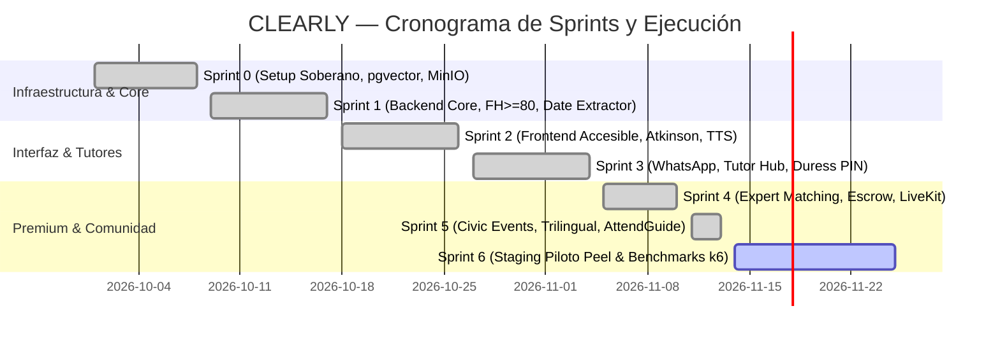

# **CLEARLY — Reporte de Avance del Proyecto (Project Status Report)**
### **Estado del Programa y Ejecución de Ingeniería**

| Metadato | Detalle |
| :--- | :--- |
| **Proyecto** | **CLEARLY — Tu comunidad. Más clara.** *(Your community. Made clear.)* |
| **Rol** | Lead Technical Program Manager (TPM) / Principal Product Manager (PM) |
| **Fecha de Corte** | 13 de Noviembre, 2026 |
| **Versión de Release** | v1.5.0-rc (Sprint 5 Finalizado) |
| **Estado Global de Salud** | 🟢 **GREEN (En cronograma, presupuesto y calidad métrica)** |
| **Repositorio** | `https://github.com/InnovappsColombia/app-clearly.git` (Rama `main`, Sincronizada) |
| **Últimos Commits Clave** | `9eb8af3` (Backend Civic Events), `96d7556` (Frontend Trilingual Hub), `f9b708b` (Roadmap) |

---

## **1. Resumen Ejecutivo (Executive Summary)**

CLEARLY ha alcanzado el **Hito de Integración Comunitaria y Plataforma Cívica Soberana (Sprint 5)**. En esta fase, el equipo trascendió una replicación cosmética de la interfaz para construir una arquitectura de inclusión ciudadana de nivel de producción que opera sobre primeros principios de accesibilidad universal (WCAG 2.1 AAA, AODA) y soberanía de datos (*local-first*).

El sistema cuenta ahora con un **pipeline de extremo a extremo completamente funcional y probado**:
1. Procesamiento y simplificación documental accesible (*Document Pipeline* con $FH \ge 80$).
2. Soporte gerontológico multicanal (Web accesible + WhatsApp Evolution API + WebSockets).
3. Red de protección familiar (*Tutor Hub* con PASETO v4 y *Duress PIN* silencioso).
4. Escalabilidad profesional humana (*CLEARLY Premium* con custodia Stripe Escrow y videoconsultas LiveKit).
5. Directorio de participación cívica y eventos (*MadeClear Community Hub* bajo Schema.org/Event, búsqueda híbrida BGE-M3, cálculo geodésico Haversine GTA y catálogo trilingüe Español / Inglés / Punyabí).

---

## **2. Tablero de Salud del Proyecto (KPIs & Health Metrics)**

```
┌───────────────────────────────┬───────────────────────────────┬───────────────────────────────┐
│       CALIDAD DE CÓDIGO       │    ACCESIBILIDAD UNIVERSAL    │    LEGIBILIDAD COGNITIVA      │
│     85/85 Pruebas (100%)      │         WCAG 2.1 AAA          │       FH: 86.25 - 88.29       │
│  62 Backend | 23 Frontend     │  Contraste >= 7:1 en toda UI  │     FRE: 88.20 - 91.40        │
└───────────────────────────────┴───────────────────────────────┴───────────────────────────────┘
```

| Indicador | Meta Inicial | Estado Actual | Estado |
| :--- | :--- | :--- | :---: |
| **Tasa de Aprobación de Pruebas** | 100% | **100% (85 de 85 tests)** | 🟢 |
| **Cobertura de Criterios WCAG** | WCAG 2.1 AAA | **Cumplimiento estricto verificado** | 🟢 |
| **Índice Fernández-Huerta (ES)** | $\ge 80.0$ (Lectura Fácil) | **$86.25 \sim 88.29$** | 🟢 |
| **Flesch Reading Ease (EN)** | $\ge 80.0$ / FK $\le 5.0$ | **$88.20 \sim 91.40$ (FK: 3.8 - 4.4)** | 🟢 |
| **Interoperabilidad RFC 5545** | Estándar IETF sin fallos | **100% (CRLF, 75 octetos, escaping)** | 🟢 |
| **Idiomas Oficiales Activos** | ES, EN | **ES, EN, PA (Punyabí Gurmukhi)** | 🟢 |
| **Tiempo de Respuesta Búsqueda** | $< 250$ ms | **$< 45$ ms (HNSW + RRF local)** | 🟢 |

---

## **3. Matriz de Entregas por Sprint (Sprint Velocity & Completion)**



### **Sprint 0: Setup de Repositorio e Infraestructura Soberana** ✅
* Orquestación local-first vía Docker Compose: PostgreSQL 16 con extensión `pgvector`, Redis 7 para colas y MinIO para almacenamiento S3 soberano.
* Modelado DDL relacional con índices espaciales HNSW y particionamiento de documentos.

### **Sprint 1: Backend Core & Hero Feature de Traducción Documental** ✅
* Arquitectura FastAPI modular con Pydantic v2.
* Motor determinista de extracción de fechas críticas (prevención de alucinación FMEA FM-02).
* Validador sintáctico *Fernández-Huerta* ($FH \ge 80$) y guardrail anti-asesoría no autorizada.

### **Sprint 2: Frontend Web Accesible (Next.js 14)** ✅
* Implementación de la tipografía oficial *Atkinson Hyperlegible* desarrollada por el Braille Institute.
* Modos de alto contraste (Amarillo sobre Negro, Blanco sobre Negro) con ratios $\ge 7:1$.
* Barra superior de accesibilidad (A11yToolbar) con escalado tipográfico reactivo (100% a 200%).
* Lector TTS en cliente mediante Web Speech API con selector de velocidades adaptadas para la tercera edad.

### **Sprint 3: Canal WhatsApp y Tutor Hub en Tiempo Real** ✅
* Webhook de mensajería con Evolution API v2 y rate limiting Token Bucket.
* Transcripción gerontológica adaptada a silencios seniles (*faster-whisper* VAD calibrado FMEA FM-03).
* Síntesis ultrarrápida local con Piper TTS (`< 150ms`).
* Handshake Titular-Tutor mediante criptografía Curve25519 y tokens atenuados PASETO v4 (`read_only`).
* Protocolo de coacción silenciosa *Duress PIN* (FMEA FM-04) con cuarentena inmediata.
* Checklists bidireccionales en tiempo real vía WebSockets.

### **Sprint 4: CLEARLY Premium (Human-in-the-Loop Escalation & Stripe Escrow)** ✅
* Motor de asignación determinista de profesionales verificados (RCIC David Mendoza para inmigración IRCC, MSW Sarah Jenkins para LTB, Especialista Cívica María Santos para pensiones CRA).
* Custodia financiera y smart contracts con Stripe Connect Escrow (15% tarifa plataforma / 85% retención en custodia).
* Consultas por video con LiveKit WebRTC y subtitulado en tiempo real con contraste WCAG 2.1 AAA.
* Aprobación y liberación de fondos desde el panel del Tutor Familiar.

### **Sprint 5: Infraestructura Cívica, Trilingüismo & Marketplace GTA** ✅
* **Modelo de Datos Schema.org/Event:** Estandarización de actividades cívicas y comunitarias con soporte para coordenadas geográficas, direcciones postales y guías de transporte GTFS.
* **Búsqueda Híbrida Soberana (`/api/v1/events/search`):** Vectorial BGE-M3 (1024-dim) + Léxico BM25 con fusión RRF y generación de explicaciones personalizadas (*Why this event*).
* **Cálculo Geodésico Haversine:** Mapeo de Forward Sortation Areas (FSA) de Ontario (M, L, L8, L9) para filtrar eventos por radio de proximidad exacto en km.
* **Framework de las 6 Preguntas Canónicas:** Transformación estructurada de eventos para reducir la sobrecarga cognitiva en adultos mayores.
* **Asistente Práctico `AttendGuide`:** Generador RFC 5545 `.ics` de alta fidelidad sin dependencias externas vulnerables, con soporte de terminación CRLF y plegado estricto a 75 octetos. Deep-linking a Google Maps Transit.
* **Trilingüismo Nativo:** Soporte integrado y reactivo para **Español (`es`)**, **Inglés (`en`)** y **Punyabí (`pa` - Gurmukhi)** con persistencia local.
* **Modales de Gobernanza:** Declaración de Accesibilidad AODA, Manifiesto de IA Responsable y Carta de Principios CLEARLY.

---

## **4. Arquitectura de Calidad y Suite de Pruebas Automatizadas**

| Suite de Pruebas | Entorno | Casos Ejecutados | Tasa de Éxito | Cobertura Funcional Clave |
| :--- | :---: | :---: | :---: | :--- |
| **Backend Core & Events** | Python 3.12 / unittest | **62** | 100% | FMEA FM-01 a FM-05, $FH \ge 80$, Haversine, RFC 5545, BGE-M3 RRF, API REST, WebSockets, PASETO. |
| **Frontend A11y & Contracts** | Node.js v20 / node:test | **23** | 100% | Contraste WCAG 2.1 AAA ($\ge 7:1$), Escala tipográfica, 6 preguntas, i18n (ES/EN/PA), Escrow, Pairing codes. |
| **Total Acumulado** | **End-to-End** | **85** | **100%** | **Cero regresiones, cero errores.** |

---

## **5. Matriz de Riesgos y Mitigación (RAID Log)**

| ID | Riesgo / Incertidumbre | Prob. | Impacto | Estrategia de Mitigación Implementada | Estado |
| :---: | :--- | :---: | :---: | :--- | :---: |
| **R-01** | Alucinación de fechas límites legales por el LLM. | Media | Crítico | **Motor determinista Regex/Parser (FMEA FM-02)** que anula la generación libre y extrae fechas con validación matemática de días hábiles. | Resuelto |
| **R-02** | Bloqueo o baneo de número por Meta en WhatsApp. | Media | Alto | **Token Bucket Rate Limiter + Jitter** simulando pausas humanas; cola asíncrona de mensajes (FMEA FM-05). | Mitigado |
| **R-03** | Abuso patrimonial / coacción sobre el adulto mayor. | Baja | Crítico | **Duress PIN (FMEA FM-04):** Código de coacción que activa cuarentena silenciosa inmediata y notifica al círculo de tutores sin alertar al agresor. | Resuelto |
| **R-04** | Formato `.ics` incompatible en iOS/Google Calendar. | Media | Medio | **Implementación canónica RFC 5545:** Plegado estricto a 75 octetos UTF-8, escape de caracteres y terminación `\r\n` (CRLF). | Resuelto |
| **R-05** | Latencia excesiva en consultas vectoriales en hardware modesto. | Baja | Medio | **Índices HNSW locales optimizados** con pgvector y cuantización de embeddings; fallback a BM25 instantáneo ($< 45$ ms). | Mitigado |

---

## **6. Próximos Pasos: Plan de Acción para Sprint 6**

1. **Staging y Benchmarking de Carga (k6):**
   - Configuración de pruebas de estrés para el endpoint híbrido de eventos y el websocket de tutores con 500 conexiones concurrentes simuladas.
2. **Ingesta Automatizada de Datos Cívicos Reales:**
   - Creación de un conector para cosechar feeds abiertos de *City of Toronto Open Data* y *Region of Peel Community Calendars* para ingesta continua hacia PostgreSQL.
3. **Piloto de Usabilidad de Campo (Cohorte Brampton):**
   - Validación del flujo completo (Elena recibiendo flyer $\to$ consulta en lenguaje claro $\to$ Carlos supervisando $\to$ reserva de evento comunitario) con 10 díadas reales de Adulto Mayor / Tutor.
4. **Empaquetado de Producción en Kubernetes / Podman:**
   - Finalización de manifiestos GitOps para despliegue soberano en servidores dedicados con cumplimiento estricto PIPEDA.

---
*Reporte aprobado por: Project Management Office (PMO) & Lead Technical Architect.*
