# **CLEARLY — Módulo RAG Local y Persistencia Soberana SQLite / sqlite-vec**
### **Arquitectura Local-First, Búsqueda Híbrida BGE-M3 y Auditoría de Legibilidad Gerontológica**

---

## **1. Resumen Ejecutivo y Soberanía de Datos**

El módulo **RAG Local de CLEARLY** (`/RAG`) implementa una arquitectura soberana de recuperación aumentada por generación (*Retrieval-Augmented Generation*) diseñada específicamente para operar en entornos locales y edge (dispositivos de adultos mayores, hubs de tutores familiares y nodos comunitarios desconectados). 

### **Pilares de Soberanía Técnica:**
1. **Cero Fuga de Datos (*Zero Egress Privacy*):** Cumplimiento estricto de **PIPEDA (Canadá)** y **GDPR**. Ningún byte de los documentos legales, cartas oficiales o extractos bancarios escaneados abandona el almacenamiento local.
2. **Persistencia Embebida SQLite + `sqlite-vec`:** Almacenamiento ACID sin dependencias de servidores externos ni Docker pesados, utilizando la extensión de alto rendimiento `sqlite-vec` (`vec0`) para índices vectoriales densos de 1024 dimensiones en espacio coseno.
3. **Búsqueda Híbrida Soberana con RRF:** Fusión recíproca de rangos (*Reciprocal Rank Fusion*, $k=60$) que combina búsqueda léxica BM25 (FTS5) y similitud semántica densa (BGE-M3).
4. **Guardrail de Legibilidad Gerontológica:** Validación algorítmica obligatoria de los textos generados para garantizar comprensión en adultos mayores:
   - **Español:** Índice Fernández-Huerta $\ge 80.0$ (*Lectura Muy Fácil / Fácil*).
   - **Inglés:** Flesch Reading Ease $\ge 80.0$ (*6th grade level*).
5. **Anti-Alucinación y Trazabilidad:** Cada respuesta cita obligatoriamente el fragmento de origen `[Fragmento: X]` y prohíbe la invención de fechas o sanciones, recomendando la derivación a un experto humano verificado en **CLEARLY Premium** ante avisos de alto riesgo (desalojos LTB, audiencias IRCC, auditorías CRA).

---

## **2. Topología del Módulo (`/RAG`)**

```
RAG/
├── __init__.py                 # Interfaces unificadas exportadas
├── config.py                   # Configuración soberana (Pydantic v2)
├── cli.py                      # Interfaz de línea de comandos (CLI)
├── README.md                   # Esta documentación técnica
├── storage/                    # Capa de almacenamiento SQLite + sqlite-vec
│   ├── __init__.py
│   ├── schema.sql              # DDL relacional, FTS5, triggers e índices
│   └── sqlite_vector_store.py  # Gestor de base de datos, vec0 y búsqueda híbrida
├── chunker/                    # Fragmentación semántica estructurada
│   ├── __init__.py
│   └── semantic_chunker.py     # Chunker jerárquico adaptado a documentos oficiales
├── embeddings/                 # Motor de vectorización BGE-M3 (1024-dim)
│   ├── __init__.py
│   └── bge_m3_engine.py        # Normalización L2 y serialización binaria struct
├── prompts/                    # Plantillas de lenguaje claro y triaje
│   ├── __init__.py
│   ├── plain_language.py       # Gestor de prompts y descargos legales
│   └── templates/              # Plantillas Markdown (ES, EN, PA, 6 preguntas, QA)
├── pipeline/                   # Orquestación de inferencia y guardrails
│   ├── __init__.py
│   ├── guardrails.py           # Silabeo, Fernández-Huerta y anti-alucinación
│   └── rag_service.py          # Pipeline RAG end-to-end: Ingesta -> Búsqueda -> Generación
├── adapter/                    # Puente con Backend FastAPI
│   ├── __init__.py
│   └── backend_adapter.py      # Sincronización transparente con app core
└── tests/                      # Suite de pruebas automatizadas
    ├── __init__.py
    ├── run_rag_tests.py        # Runner maestro de tests RAG (27 tests)
    ├── test_sqlite_vector_store.py
    ├── test_semantic_chunker.py
    ├── test_bge_m3_embeddings.py
    ├── test_readability_auditor.py
    ├── test_legal_guardrails.py
    └── test_rag_pipeline.py
```

---

## **3. Esquema de Datos Soberano (SQLite DDL)**

El esquema implementado en `RAG/storage/schema.sql` y `sqlite_vector_store.py` estructura las entidades:

```mermaid
erDiagram
    DOCUMENTS ||--o{ CHUNKS : "contiene"
    CHUNKS ||--|| CHUNKS_FTS : "sincroniza FTS5"
    CHUNKS ||--|| VEC_CHUNKS : "vector 1024-dim"
    EVENTS ||--|| EVENTS_FTS : "sincroniza FTS5"
    EVENTS ||--|| VEC_EVENTS : "vector 1024-dim"

    DOCUMENTS {
        text id PK
        text user_id
        text filename
        text file_sha256
        text content
        text plain_summary
        text issuing_entity
        text urgency
        text critical_deadline
        real fernandez_huerta_score
    }
    CHUNKS {
        text id PK
        text document_id FK
        integer chunk_index
        text content
        integer token_count
        text section_header
        blob embedding_blob
    }
    VEC_CHUNKS {
        text chunk_id PK
        float1024 embedding
    }
```



### **Virtual Tables en sqlite-vec (`vec0`)**:
```sql
CREATE VIRTUAL TABLE IF NOT EXISTS vec_chunks USING vec0(
    chunk_id text,
    embedding float[1024] distance_metric=cosine
);
```

### **Consulta Híbrida con Reciprocal Rank Fusion (RRF)**:
```sql
WITH knn AS (
    SELECT chunk_id, distance
    FROM vec_chunks
    WHERE embedding MATCH ? AND k = ?
)
SELECT knn.chunk_id, knn.distance, c.document_id, c.content, c.section_header
FROM knn
JOIN chunks c ON knn.chunk_id = c.id
ORDER BY knn.distance ASC;
```

---

## **4. Métricas de Calidad y Resultados de Pruebas**

La suite del Módulo RAG cuenta con **27 pruebas unitarias e integrales** con una tasa de éxito del **100%**:

| Suite de Pruebas | Archivo | Casos | Estado | Cobertura Funcional |
| :--- | :--- | :---: | :---: | :--- |
| **Vector Store & sqlite-vec** | `test_sqlite_vector_store.py` | 6 | 🟢 PASS | Extensión `sqlite-vec` C, `vec0`, FTS5 BM25, RRF híbrido, CRUD, eventos. |
| **Semantic Chunker** | `test_semantic_chunker.py` | 4 | 🟢 PASS | Jerarquía de encabezados, preservación de contexto, solapamiento, fechas y montos CAD. |
| **BGE-M3 Embeddings** | `test_bge_m3_embeddings.py` | 5 | 🟢 PASS | 1024 dimensiones, norma unitaria L2 ($\|v\|_2 = 1.0$), serialización binaria struct, determinismo. |
| **Readability Auditor** | `test_readability_auditor.py` | 4 | 🟢 PASS | Algoritmo Fernández-Huerta ($FH \ge 80$), Flesch Reading Ease ($FRE \ge 80$), diptongos e hiatos. |
| **Legal Guardrails** | `test_legal_guardrails.py` | 4 | 🟢 PASS | Anti-alucinación de fechas, verificación de citas `[Fragmento: X]`, descargo legal y escalamiento. |
| **End-to-End Pipeline** | `test_rag_pipeline.py` | 4 | 🟢 PASS | Ingesta de Formulario LTB N4, consultas ES/EN, adaptador Backend, fallback sin documentos. |
| **Total Módulo RAG** | **`run_rag_tests.py`** | **27** | 🟢 **100%** | **Ejecución completa en 0.096 segundos.** |

---

## **5. Uso de la Interfaz de Línea de Comandos (CLI)**

CLEARLY provee la herramienta `RAG/cli.py` para operaciones de administración, indexación y evaluación:

### **Consultar estadísticas de la base de datos:**
```bash
python RAG/cli.py stats
```

### **Indexar un documento oficial en lenguaje claro:**
```bash
python RAG/cli.py index "docs/aviso_ltb_n4.txt" --issuer "Landlord and Tenant Board" --deadline "2026-12-05"
```

### **Realizar consulta RAG soberana con auditoría de legibilidad:**
```bash
python RAG/cli.py query "¿Cuál es la fecha límite de pago y qué pasa si no pago?" --lang es
```

### **Búsqueda híbrida de eventos comunitarios:**
```bash
python RAG/cli.py events-search "taller de computación para adultos mayores" --city "Brampton"
```

