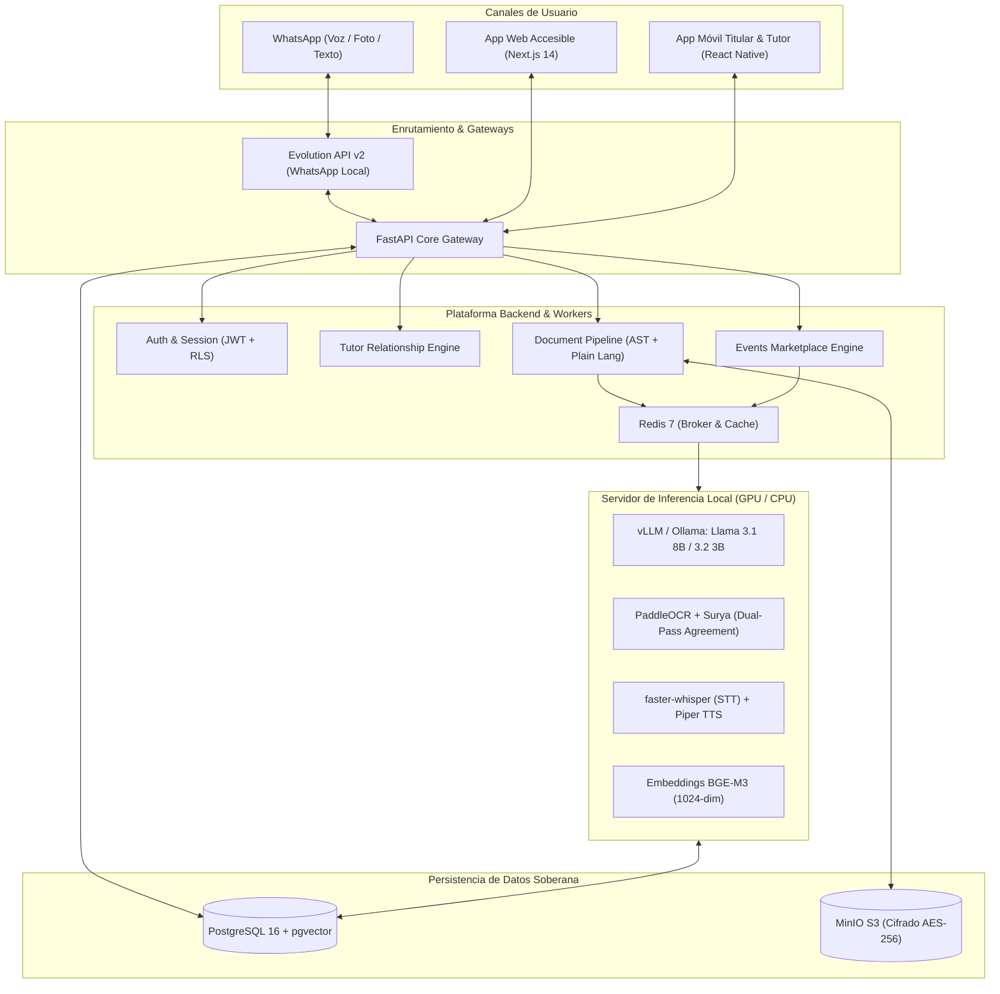

# **CLEARLY — Tu comunidad. Más clara.**
> *(Your community. Made clear.)*

[](#)
[](#)
[](#)
[](#)
[](#)

---

## **1. Visión y Propuesta de Valor**
**CLEARLY** es un ecosistema omnicanal de inclusión ciudadana, accesibilidad digital gerontológica y soberanía de datos diseñado para romper las barreras del lenguaje burocrático, la brecha tecnológica y el aislamiento social que sufren los adultos mayores, inmigrantes recién llegados (*newcomers*) y personas con baja visión.

### **Los Pilares de CLEARLY:**
* **Soberanía y Privacidad Absoluta (Local-First):** Inferencia de modelos de IA Open Source (**Llama 3.1 8B**, **PaddleOCR**, **faster-whisper**, **Piper TTS**) autohospedados localmente. Cero fuga de datos médicos o migratorios sensibles a terceros (cumplimiento estricto PIPEDA y GDPR) y cero costo variable por token.
* **Accesibilidad por Diseño (A11y):** Tipografía oficial **Atkinson Hyperlegible** (diseñada por el *Braille Institute*), contraste superior WCAG 2.1 Nivel AAA, síntesis de voz en tiempo real (*TTS*) y lenguaje simplificado (*Plain Language* auditado con la fórmula *Fernández-Huerta* $\ge 80$).
* **Omnicanalidad sin Fricción:** Acceso universal desde **WhatsApp** (vía gateways libres autohospedados como Evolution API) hasta la **App Web Accesible y Móvil**.
* **Enlace Intergeneracional (Modo Tutor):** Conexión segura con familiares o cuidadores (*"generación sándwich"*), alertas proactivas ante fechas límite críticas y panel compartido *Tutor Hub*.
* **CLEARLY Premium:** Respaldo humano verificado (trabajadores sociales, consultores de inmigración) para casos que trascienden el alcance ético y legal de la IA.

---

## **2. Arquitectura del Sistema (C4 Container View)**



---

## **3. Estructura del Repositorio**

```
app-clearly/
├── Backend/                 # Core API en FastAPI, endpoints y controladores
├── Database/                # Esquemas SQL, migraciones e inicialización
│   ├── init.sql             # Script unificado con esquema, índices HNSW y seeds
│   ├── migrations/          # Migraciones versionadas (001_initial_schema.sql)
│   └── seeds/               # Datos de prueba de Brampton/GTA (001_initial_seed.sql)
├── Documentation/           # Especificaciones maestras de producto y arquitectura
│   ├── PRD.md               # Product Requirements Document (v1.1.0)
│   ├── TRD.md               # Technical Requirements Document (v1.0.0)
│   ├── ENGINEERING_SPEC_AND_FMEA.md # FMEA, legal guardrails y benchmarks
│   ├── CLEARLY.md           # Brand manifesto y lineamientos fundacionales
│   └── clearly_brand_book.pdf # Manual de identidad gráfica y colorimetría
├── Frontend/                # Aplicación web accesible (Next.js 14) y móvil
├── RAG/                     # Wrappers de IA local, prompts y utilidades
├── .env.example             # Plantilla de variables de entorno exhaustiva
├── docker-compose.yml       # Stack local-first (Postgres, Redis, MinIO)
└── README.md                # Este documento
```

---

## **4. Puesta en Marcha Rápida (Local Infrastructure)**

### **Paso 1: Configurar Variables de Entorno**
Copia el archivo `.env.example` a `.env`:
```bash
cp .env.example .env
```

### **Paso 2: Levantar la Infraestructura Base con Docker**
Ejecuta los servicios fundamentales (PostgreSQL con `pgvector`, Redis y MinIO con buckets automáticos):
```bash
docker compose up -d
```

### **Paso 3: Verificar Estado de los Servicios**
```bash
docker compose ps
```

| Servicio | Puerto Host | Descripción | Credenciales por Defecto |
| :--- | :--- | :--- | :--- |
| **PostgreSQL 16** | `5432` | DB relacional + búsqueda vectorial HNSW | `clearly_admin` / `clearly_secure_pass_2026!` (DB: `clearly_db`) |
| **Redis 7** | `6379` | Broker de mensajes y caché de sesiones | Sin contraseña en dev |
| **MinIO S3** | `9000` | Almacenamiento S3 de documentos y audios | `clearly_minio_admin` / `clearly_minio_secret_key_2026!` |
| **MinIO Console** | `9001` | Interfaz web de administración de objetos | http://localhost:9001 |
| **LiveKit WebRTC Server** | `7880` / `7881` | Servidor de videoconferencia y subtítulos accesibles en tiempo real | `devkey` / `secret` |
| **Backend Core (FastAPI)** | `8000` | API REST & Hero Feature de Documentos | http://localhost:8000/docs |
| **Frontend Web (Next.js 14)** | `3000` | App Web Accesible WCAG 2.1 AAA | http://localhost:3000 |

### **Paso 4: Comprobar la Base de Datos y Extensión Vectorial**
Conéctate a PostgreSQL para verificar que la extensión `vector` y los datos semilla estén activos:
```bash
docker exec -it clearly-postgres psql -U clearly_admin -d clearly_db -c "\dx"
docker exec -it clearly-postgres psql -U clearly_admin -d clearly_db -c "SELECT full_name, role FROM users;"
docker exec -it clearly-postgres psql -U clearly_admin -d clearly_db -c "SELECT raw_title, made_clear_cost FROM community_events;"
```

### **Paso 5: Ejecución Local del Frontend Web Accesible**
```bash
cd Frontend/web-app
npm install
npm run dev      # Servidor de desarrollo en http://localhost:3000
npm run build    # Compilación optimizada de producción
npm test         # Pruebas automatizadas de accesibilidad y contraste WCAG AAA
```

---

## **5. Hoja de Ruta de Sprints**

- [x] **Sprint 0: Setup de Repositorio e Infraestructura Soberana**
  - [x] Inicialización de Git y reglas `.gitignore` / `.gitattributes`.
  - [x] Orquestación Docker Compose (`PostgreSQL 16 + pgvector`, `Redis 7`, `MinIO`).
  - [x] Modelado DDL completo en `/Database` con índices HNSW y seed data de Brampton.
- [x] **Sprint 1: Backend Core & Hero Feature de Traducción Documental**
  - [x] Setup de FastAPI en `/Backend` con Pydantic v2.
  - [x] Motor de extracción de fechas determinista (evita alucinación de plazos).
  - [x] Auditor sintáctico *Fernández-Huerta* ($FH \ge 80$) y guardrail legal anti-asesoría.
  - [x] Endpoint `/api/v1/documents/process` con soporte MinIO y PostgreSQL.
- [x] **Sprint 2: Frontend Web Accesible (Next.js 14)**
  - [x] Tipografía oficial *Atkinson Hyperlegible* y temas de alto contraste (WCAG 2.1 AAA).
  - [x] Barra superior de accesibilidad (A11yToolbar) con selector de escala de fuente (100% a 200%).
  - [x] Componente accesible de subida (cámara/archivos) y visualización en 3 capas.
  - [x] Lector TTS en navegador (Web Speech API) con control de velocidad (0.75x a 1.25x).
  - [x] Banner protector de enlace familiar (*Modo Tutor*) y Marketplace *Made Clear*.
  - [x] Suite de pruebas automatizadas de ratios de contraste y contratos A11y.
- [x] **Sprint 3: Canal WhatsApp (Evolution API) y Tutor Hub en Tiempo Real**
  - [x] Webhook de mensajería con Evolution API v2 (`/api/v1/webhooks/whatsapp`) con rate limiting Token Bucket y protección anti-baneo Meta (FMEA FM-05).
  - [x] Transcripción gerontológica de audios con faster-whisper (calibración VAD para pausas seniles FMEA FM-03) y síntesis ultrarrápida con Piper TTS (`< 150ms`).
  - [x] Motor de Handshake efímero Titular-Tutor (Curve25519) con tokens atenuados PASETO v4 (`action=read_only`).
  - [x] Protocolo de coacción silenciosa *Duress PIN* (FMEA FM-04) contra abuso patrimonial con cuarentena instantánea.
  - [x] Sincronización colaborativa de checklists en tiempo real vía WebSockets (`/api/v1/ws/tutors/{senior_id}`).
  - [x] Panel interactivo Tutor Hub en Frontend Web (Next.js 14) accesible WCAG 2.1 AAA con selector de roles y checklist bidireccional.
  - [x] Suite de pruebas automatizadas: 41 tests backend y 11 tests frontend con 100% de aprobación.
- [x] **Sprint 4: CLEARLY Premium (Human-in-the-Loop Escalation & Stripe Escrow)**
  - [x] Motor de emparejamiento automático determinista según tipo documental (IRCC $\to$ RCIC David Mendoza, LTB $\to$ MSW Sarah Jenkins, CRA $\to$ Especialista Cívica María Santos) con justificación en lenguaje claro ($FH \ge 80$).
  - [x] Custodia financiera y contratos inteligentes con Stripe Connect Escrow (15% tarifa plataforma CLEARLY / 85% retención en custodia para el profesional verificado).
  - [x] Videoconsultas médicas y legales con LiveKit WebRTC y subtitulado gerontológico en vivo (escala tipográfica 1.5x a 2.0x, contraste WCAG 2.1 AAA $\ge 7:1$).
  - [x] Modal interactivo de reserva CLEARLY Premium en Frontend Web (`ExpertBookingModal.tsx`) con delegación de pago a tutor familiar y sala de consulta accesible (`LiveKitVideoPreview.tsx`).
  - [x] Supervisión y liberación de custodia Escrow desde el panel de Tutor Hub (`TutorHubDashboard.tsx`).
  - [x] Pruebas automatizadas exhaustivas: 48 tests backend y 18 tests frontend (100% aprobadas).
- [x] **Sprint 5: Integración Comunitaria Lovable, Trilingüismo & Marketplace GTA**
  - [x] Buscador conversacional en lenguaje natural *Ask CLEARLY* con chips de intención rápida y explicaciones *Why this event*.
  - [x] Selector dual de visualización de eventos: Modo Simple vs Modo CLEARLY con las 6 preguntas canónicas de lenguaje claro.
  - [x] Guía práctica interactiva de asistencia (`AttendGuideModal`) con generador dinámico de calendarios RFC 5545 (`.ics`) y enlace directo a Google Maps en modo transporte público (*travelmode=transit*).
  - [x] Sistema de filtros cívicos avanzados: selector de los 9 municipios del Gran Toronto (GTA), filtro por costo (Gratis/Pago) y cálculo de proximidad por código postal (Haversine).
  - [x] Soporte nativo trilingüe completo: **Español (`es`)**, **Inglés (`en`)** y **Punyabí (`pa` - ਪੰਜਾਬੀ)** con selector de idioma en barra accesible.
  - [x] Pestañas de persistencia en `localStorage`: *Mis Eventos* (Going) y *Guardados* (Bookmarks).
  - [x] Modales de gobernanza ciudadana: Declaración de Accesibilidad (WCAG 2.1 AAA), IA Responsable y Manifiesto CLEARLY.
  - [x] Pruebas automatizadas actualizadas: 23 tests frontend con 100% de aprobación.

---

## **6. Documentos de Referencia del Proyecto**
* [Product Requirements Document (PRD)](file:///d:/IA-PROJECTS/app-clearly/Documentation/PRD.md)
* [Technical Requirements Document (TRD)](file:///d:/IA-PROJECTS/app-clearly/Documentation/TRD.md)
* [Engineering Spec & FMEA Analysis](file:///d:/IA-PROJECTS/app-clearly/Documentation/ENGINEERING_SPEC_AND_FMEA.md)
* [Brand Book & Manifesto CLEARLY](file:///d:/IA-PROJECTS/app-clearly/Documentation/CLEARLY.md)

